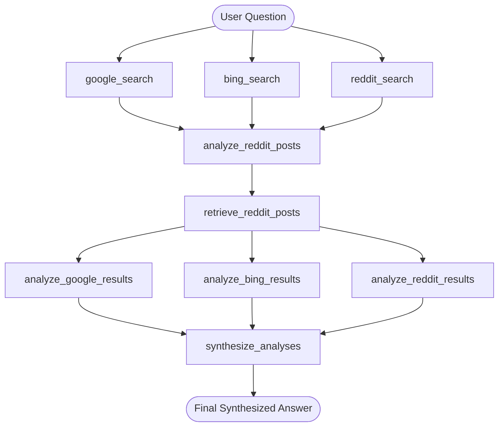

# AI Multi-Search Agent 🌐🤖

<p align="center">
  
  
  
  
  
</p>

**AI Multi-Search Agent** is a multi-source retrieval and synthesis pipeline built with **LangGraph** and **LangChain**. It dispatches parallel search queries across **Google Search**, **Bing Search**, and **Reddit Communities** (via BrightData SERP & Dataset APIs), extracts top Reddit post discussions, analyzes each source independently, and synthesizes a unified answer.

---

## 🏗️ Retrieval & Synthesis Graph (`main.py`)



---

## 🛠️ Project Structure

```
ai-multi-search-agent/
├── main.py                    # 9-node LangGraph workflow & CLI runner
├── streamlit.py               # Interactive Streamlit dashboard
├── web_operations.py          # Google, Bing, and Reddit search API connectors
├── snapshot_operations.py     # Async dataset snapshot polling & downloader
├── prompts.py                 # Source-specific analysis & synthesis prompt templates
├── pyproject.toml             # Package metadata & dependencies
├── requirements.txt           # Production dependencies
├── .env.example               # Environment variables template
└── README.md                  # Project documentation
```

---

## 📦 Quick Start Guide

### 1. Clone Repository

```bash
git clone https://github.com/alhaj-ai/ai-multi-search-agent.git
cd ai-multi-search-agent
```

### 2. Environment Setup

```bash
python -m venv venv
venv\Scripts\activate
pip install -r requirements.txt
```

### 3. API Configuration

Copy `.env.example` to `.env` and configure your keys:

```ini
OPENAI_API_KEY=your_openai_api_key_here
BRIGHTDATA_API_KEY=your_brightdata_api_key_here
```

### 4. Run Application

#### Streamlit Dashboard:
```bash
streamlit run streamlit.py
```

#### CLI Mode:
```bash
python main.py
```

---

## 👨‍💻 Author

Developed by **[Mohammed Al-Haj](https://github.com/alhaj-ai)**
- 📧 Email: `ai.mohammed.alhaj@gmail.com`
- 🐙 GitHub: [@alhaj-ai](https://github.com/alhaj-ai)
